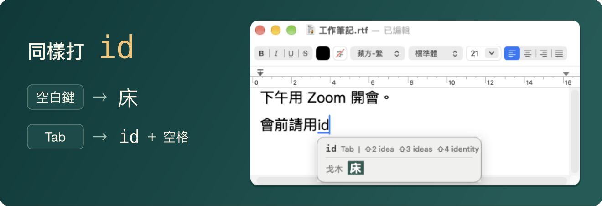

<div align="center">


# Goshawk IME · 蒼鷹輸入法

**Type Traditional Chinese with Cangjie and English on macOS without switching input sources.**

macOS 14+ · Apple Silicon & Intel · Apple Notarized · Cangjie 3 & 5 · Offline & Private · MIT

<p>
  <a href="https://github.com/kcchien/goshawk-ime/releases/latest/download/GoshawkIME.dmg"><strong>Download for Mac (.dmg)</strong></a>
  &nbsp;·&nbsp;
  <a href="https://goshawk.kcchien.com/?lang=en"><strong>30-Second Interactive Guide</strong></a>
  &nbsp;·&nbsp;
  <a href="#shortcuts">Shortcuts</a>
  &nbsp;·&nbsp;
  <a href="#faq">FAQ</a>
  &nbsp;·&nbsp;
  <a href="README.md">繁體中文</a>
</p>

<br>

<picture>
  <source media="(max-width: 600px)" srcset="artwork/mixed-input.png">
  
</picture>

</div>

---

Type Chinese normally with <kbd>␣ Space</kbd>, accept English words with <kbd>⇥ Tab</kbd> (automatic spacing included), or keep exact casing like `Zoom` with <kbd>↵ Enter</kbd>. Try it right in your browser with the **[30-second interactive guide](https://goshawk.kcchien.com/?lang=en)** ([Markdown guide](https://goshawk.kcchien.com/guide.md) · [llms.txt](https://goshawk.kcchien.com/llms.txt)).

---

## Install

Requires **macOS 14 or later** (Universal binary for Apple Silicon and Intel, Developer ID signed and Apple notarized).

### Option 1: Download `.dmg` (Recommended)

1. Download and open **[GoshawkIME.dmg](https://github.com/kcchien/goshawk-ime/releases/latest/download/GoshawkIME.dmg)**.
2. Double-click **GoshawkIME** and click **Install**.
3. Select **Goshawk** from the macOS menu bar input menu.

### Option 2: One-Line Terminal Install

```sh
curl -fsSL https://raw.githubusercontent.com/kcchien/goshawk-ime/main/scripts/install.sh | bash
```

---

## Highlights

- **Mix Chinese and English without switching**: Press <kbd>␣ Space</kbd> for Cangjie and <kbd>⇥ Tab</kbd> for English. Slipped? Press <kbd>⇧ Shift</kbd> + <kbd>␣ Space</kbd> immediately to swap Chinese and English, or toggle `,` and `，` without hitting Delete.
- **8 paired quotes & brackets from <kbd>[</kbd> and <kbd>]</kbd>**: Cycle `「」`, `[ ]`, `『』`, `《》`, `〈〉`, `【】`, `“”`, and `‘’`. <kbd>]</kbd> matches the nearest open bracket automatically; press <kbd>⇧ Shift</kbd> + <kbd>␣ Space</kbd> then <kbd>1</kbd>–<kbd>8</kbd> right after closing to switch the whole pair.
- **Write code inside backticks (<kbd>`</kbd>)**: Backticks switch to English-first typing with halfwidth punctuation and no extra spacing, then restore your Chinese punctuation rhythm when closed.
- **Forgot a Cangjie code? Look it up with Zhuyin or Pinyin**: Press <kbd>⌃ Ctrl</kbd> + <kbd>⇧ Shift</kbd> + <kbd>;</kbd> to look up Cangjie 3 or 5 codes without losing your buffer, or press <kbd>⌥ Option</kbd> + <kbd>⇧ Shift</kbd> + <kbd>B</kbd> for 151 punctuation marks and symbols.
- **Offline and private**: Everything stays on your Mac. The only optional network request checks the latest public GitHub release version once a day and sends zero user data.

---

## Shortcuts

| Goal | Shortcut |
| --- | --- |
| Commit top Cangjie character (English-first inside backticks) | <kbd>␣ Space</kbd> |
| Accept English word + space | <kbd>⇥ Tab</kbd> |
| Keep exact casing (e.g. `Zoom`) | <kbd>↵ Enter</kbd> |
| Swap last Chinese/English, punctuation width, or paired brackets | <kbd>⇧ Shift</kbd> + <kbd>␣ Space</kbd> |
| Toggle Pure English mode | <kbd>⇧ Shift</kbd> <kbd>⇧ Shift</kbd> (double-tap) |
| Look up a Cangjie code by Zhuyin or Pinyin | <kbd>⌃ Ctrl</kbd> + <kbd>⇧ Shift</kbd> + <kbd>;</kbd> |
| Open Symbol Panel | <kbd>⌥ Option</kbd> + <kbd>⇧ Shift</kbd> + <kbd>B</kbd> |

---

## FAQ

**Does Goshawk support both Cangjie 3 and Cangjie 5?**  
Yes. Cangjie 3 is the default, and you can switch to Cangjie 5 anytime in Settings. One universal `.dmg` supports Apple Silicon and Intel Macs running macOS 14 or later.

**Is any typing data sent over the internet?**  
No. All composition, English predictions, Zhuyin/Pinyin lookup, and optional adaptive ordering run 100% locally. The optional daily update check queries only the latest public GitHub release tag and can be turned off in Settings.

**How do I uninstall Goshawk?**  
Run `~/Library/Input\ Methods/GoshawkIME.app/Contents/MacOS/GoshawkApp --uninstall` in Terminal.

---

## License & Credits

Source code is licensed under the [MIT License](LICENSE). Third-party lexicon sources and attributions are listed in [THIRD_PARTY_NOTICES.md](THIRD_PARTY_NOTICES.md).
