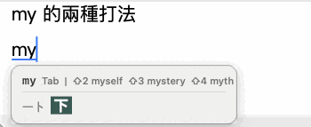
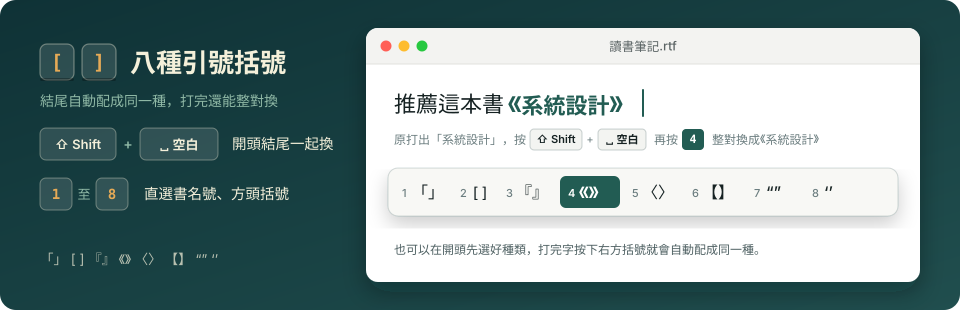
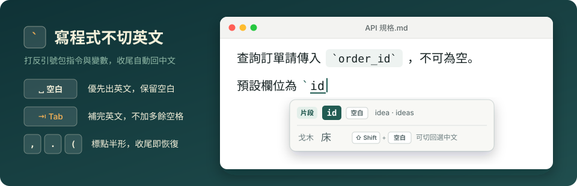
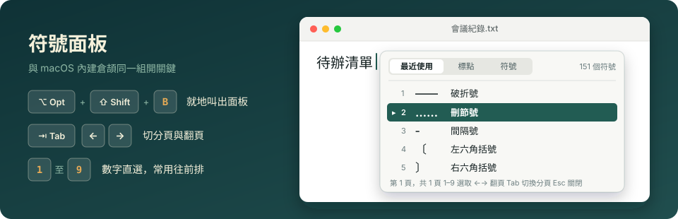

<div align="center">


# 蒼鷹輸入法 · Goshawk IME

**在 macOS 上用倉頡打字，不必再為了夾雜英文來回切換輸入法。**

macOS 14+ · Apple Silicon & Intel · Apple 公證 · 倉頡三代／五代 · 純離線運作 · MIT 開源

<p>
  <a href="https://github.com/kcchien/goshawk-ime/releases/latest/download/GoshawkIME.dmg"><strong>下載 Mac 版（.dmg）</strong></a>
  &nbsp;·&nbsp;
  <a href="https://goshawk.kcchien.com"><strong>30 秒線上試打與指南</strong></a>
  &nbsp;·&nbsp;
  <a href="#常用按鍵速查">快捷鍵</a>
  &nbsp;·&nbsp;
  <a href="#常見問答">常見問答</a>
  &nbsp;·&nbsp;
  <a href="README.en.md">English</a>
</p>

<br>

<picture>
  <source media="(max-width: 600px)" srcset="artwork/mixed-input.png">
  
</picture>

</div>

---

寫「下午用 Zoom 開會」或「會前請用 id 查訂單」時，中文照原本習慣按 <kbd>␣ 空白</kbd>，英文直接拼完按 <kbd>⇥ Tab</kbd>（自動補一格空格），專有名詞按 <kbd>↵ Enter</kbd> 保留大小寫。

蒼鷹取自「倉頡」與「英文」合稱「倉英」的同音。想先體驗手感？打開 **[30 秒線上試打與使用指南](https://goshawk.kcchien.com)**（[純 Markdown 版](https://goshawk.kcchien.com/guide.md) · [llms.txt](https://goshawk.kcchien.com/llms.txt)），免安裝就能在瀏覽器直接試打。

---

## 安裝

支援 **macOS 14 或以上版本**（Apple Silicon 與 Intel 單一通用執行檔，皆通過 Apple Developer ID 簽章與公證）。

### 方式一：下載 dmg 安裝（推薦）

1. 下載並打開 **[GoshawkIME.dmg](https://github.com/kcchien/goshawk-ime/releases/latest/download/GoshawkIME.dmg)**。
2. 點兩下裡面的 **GoshawkIME**，在視窗按「安裝」。
3. 看到「安裝完成」後按「好」，再從右上角選單列切到 **蒼鷹輸入法**（英文系統顯示 **Goshawk**）。

### 方式二：終端機一行指令

```sh
curl -fsSL https://raw.githubusercontent.com/kcchien/goshawk-ime/main/scripts/install.sh | bash
```

自動下載最新版、驗證 Apple 簽章並完成安裝（[檢視腳本](scripts/install.sh)）。

### 方式三：交給 AI 代理安裝

把這句話貼給能操作這台 Mac 的 AI 代理即可（完整步驟見 [INSTALL.md](INSTALL.md)）：

```text
請依照 https://raw.githubusercontent.com/kcchien/goshawk-ime/main/INSTALL.md 的步驟，在這台 Mac 安裝蒼鷹輸入法。
```

> 切到蒼鷹後，在任何輸入框按 <kbd>m</kbd> <kbd>y</kbd> <kbd>␣ 空白</kbd>，出現「下」就裝好了。選單找不到請到「系統設定 → 鍵盤 → 文字輸入 → 繁體中文」加入；覆蓋升級後若仍出現舊版行為，登出再登入即可。

---

## 五個最有感的日常體驗

### 1. 中英直接混打，按錯不用重打

按 <kbd>␣ 空白</kbd> 出中文、<kbd>⇥ Tab</kbd> 出英文並自動補空格、<kbd>↵ Enter</kbd> 保留 <code>Zoom</code>、<code>macOS</code> 原樣大小寫。按錯空白鍵不用刪字，立刻按 <kbd>⇧ Shift</kbd> + <kbd>␣ 空白</kbd> 就能互換中英文，或是把英文後的逗號 <code>GitHub,</code> 換成全形「GitHub，」。

<div align="center">
  
</div>

### 2. 用方括號打出八種常用引號與括號

光靠 <kbd>[</kbd> 和 <kbd>]</kbd> 就能打出 `「」`、`[ ]`、`『』`、`《》`、`〈〉`、`【】`、`“”`、`‘’` 八種配對。結尾自動配成同一種；打完立刻按 <kbd>⇧ Shift</kbd> + <kbd>␣ 空白</kbd> 再按 <kbd>1</kbd> 至 <kbd>8</kbd>，開頭與結尾整對一起換。整對超過 32 個字或跨行時不換，按鍵不會改到文字，游標旁會提示原因，不會只換掉結尾。

<div align="center">
  
</div>

### 3. 用反引號寫指令與程式碼，不必切英文

打一個反引號 <kbd>`</kbd> 即改為英文優先、標點全半形、<kbd>⇥ Tab</kbd> 補完不加多餘空格、也不補中英間距；收尾反引號後自動恢復原本的中文標點習慣。

<div align="center">
  
</div>

### 4. 忘了倉頡怎麼拆？原地用注音或拼音查字

按 <kbd>⌃ Ctrl</kbd> + <kbd>⇧ Shift</kbd> + <kbd>;</kbd> 就地開啟查拆碼面板（原本正在打的字母會留著），支援標準大千注音與漢語拼音（按 <kbd>⇥ Tab</kbd> 切換），直接列出目前代別的字母碼與字根。

<div align="center">
  
</div>

### 5. 內建 151 個標準標點與符號面板

按 <kbd>⌥ Option</kbd> + <kbd>⇧ Shift</kbd> + <kbd>B</kbd>（和 macOS 內建倉頡同一組鍵）開啟「最近使用」「標點」「符號」三分頁，按數字鍵直接輸入，常用符號自動排到最前面。

<div align="center">
  
</div>

---

## 常用按鍵速查

蒼鷹預設為 **倉頡三代**，習慣五代可在選單列「設定…」即時切換。

| 想做什麼 | 按鍵 |
| --- | --- |
| 打出倉頡首選字（反引號裡優先出英文） | <kbd>␣ 空白</kbd> |
| 在中文裡夾一個英文詞並自動補空格 | <kbd>⇥ Tab</kbd> |
| 保留原本大小寫（如 `Zoom`），字尾不加空格 | <kbd>↵ Enter</kbd> |
| 打完立刻互換中英文、標點全半形或八種引號括號 | <kbd>⇧ Shift</kbd> + <kbd>␣ 空白</kbd> |
| 打「」『』《》【】等八種成對引號括號 | <kbd>[</kbd> <kbd>]</kbd>，打完接 <kbd>⇧ Shift</kbd> + <kbd>␣ 空白</kbd> 與 <kbd>1</kbd>–<kbd>8</kbd> |
| 連續打一整段英文（再按一次返回） | <kbd>⇧ Shift</kbd> <kbd>⇧ Shift</kbd>（連按兩下） |
| 忘了倉頡怎麼拆，用注音或拼音查字 | <kbd>⌃ Ctrl</kbd> + <kbd>⇧ Shift</kbd> + <kbd>;</kbd> |
| 開啟符號面板 | <kbd>⌥ Option</kbd> + <kbd>⇧ Shift</kbd> + <kbd>B</kbd> |

想用 30 秒練熟全部手勢，或查看終端機相容說明（Ghostty / Herdr / VS Code）與可列印速查表，請前往 **[goshawk.kcchien.com](https://goshawk.kcchien.com)**。

---

## 常見問答

**支援倉頡三代還是五代？需要哪一版 macOS？**  
兩代都支援。預設倉頡三代，可在選單列「設定…」即時切換五代。安裝檔為單一通用執行檔，支援 macOS 14 以上版本的 Apple Silicon 與 Intel Mac，皆經 Apple 公證。

**從 macOS 內建倉頡換過來需要重新學拆碼嗎？**  
不需要。拆碼與空白鍵送字習慣完全不變，符號面板也沿用內建倉頡的 <kbd>⌥ Option</kbd> + <kbd>⇧ Shift</kbd> + <kbd>B</kbd>；只需多記 <kbd>⇥ Tab</kbd> 出英文與 <kbd>⇧ Shift</kbd> + <kbd>␣ 空白</kbd> 按錯互換，約 30 秒就能適應。

**安全嗎？會把打字內容上傳到網路嗎？**  
打字內容絕不離開這台 Mac。拆碼、英文預測、查拆碼與個人選字學習全部本機離線完成，原始碼以 MIT 授權公開。唯一可選的網路請求是「自動檢查更新」（每天最多向 GitHub 查一次公開版號，不含任何輸入資料或識別資訊），可在「設定 → 關於」關閉。

**在 VS Code、Ghostty、Herdr 或終端機裡好用嗎？**  
針對程式碼與終端機做過專門處理：檔名如 `my.file` 或 `cd ..` 不會誤轉全形句號，反引號裡自動改英文優先。若使用會攔截 Tab 的終端機（如 Herdr）請改按 <kbd>↵ Enter</kbd>；在 Ghostty／Herdr 打全形標點先打半形再按 <kbd>⇧ Shift</kbd> + <kbd>␣ 空白</kbd> 切換即可。

**怎麼移除蒼鷹輸入法？**  
在終端機執行下方指令即可停用輸入來源並移除 App（若要連同設定與學習紀錄一起刪除，步驟見 [INSTALL.md](INSTALL.md#6-移除)）：

```sh
~/Library/Input\ Methods/GoshawkIME.app/Contents/MacOS/GoshawkApp --uninstall
```

---

## 回報問題與從原始碼建置

遇到打字異常或想提建議，請至 [GitHub Issues](https://github.com/kcchien/goshawk-ime/issues/new/choose) 填寫表單（附上**按鍵順序、預期文字、實際文字**與使用程式）。版本與設定不必手抄，可在選單列「設定… → 關於」按「複製診斷資訊」直接貼上（只含版本、架構、系統版本與開關狀態，不含任何打字內容或個人詞彙）。

從原始碼建置與重播測試（需要 macOS 與 Swift 6 工具鏈）：

```sh
git clone https://github.com/kcchien/goshawk-ime.git
cd goshawk-ime
swift run GoshawkCLI --script "m y SPACE"   # 重播按鍵，驗證輸出「下」
bash scripts/install-ime.sh                 # 建置並安裝到目前帳號
```

原始碼入口：[核心引擎](Sources/GoshawkCore) · [macOS 介面](Sources/GoshawkApp) · [按鍵重播工具](Sources/GoshawkCLI) · [詞庫建置腳本](scripts/build-lexicon.py) · [AI 閱讀索引（llms.txt）](https://goshawk.kcchien.com/llms.txt)

完整驗證順序（需於圖形介面工作階段執行）：`swift test`、`bash scripts/verify-cli.sh`、`swift run GoshawkApp --self-test`、`bash scripts/run-formal-check.sh --max-depth 4`、`bash scripts/run-formal-check.sh --release --max-depth 5`。

---

## 授權與資料來源

程式碼採 [MIT 授權](LICENSE)。倉頡碼表來自 libcangjie，英文基礎詞表來自 orgtre/google-books-ngram-frequency，單字讀音取自全字庫，候選字常用度使用 Unicode Unihan 資料。各資料檔版本、授權與顯名聲明見 [THIRD_PARTY_NOTICES.md](THIRD_PARTY_NOTICES.md)。
