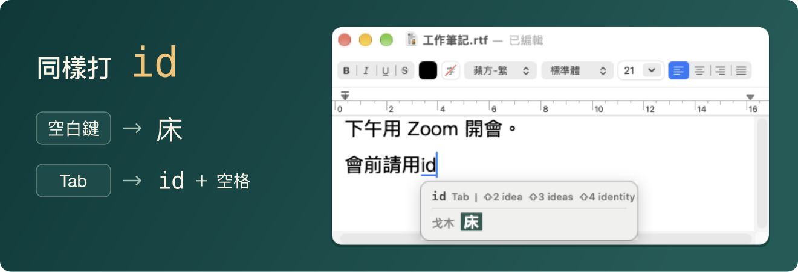
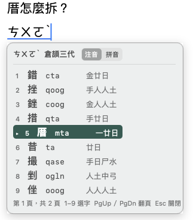

#  蒼鷹輸入法

**Goshawk IME** · Cangjie and English for macOS

用倉頡打字，碰到中英文混打時有一個常見的痛點：為了輸入英文，得先切到英文或按一些特殊鍵組合，打完再切回倉頡，很難進入心流。例如：想回一句「下午用 Zoom 開會」，或寫技術文件時，一行裡還可能有好幾個檔名和變數。而蒼鷹輸入法想省下的，就是這些來回切換造成的心流斷點。如何讓輸入中文照常拆碼，英文直接拼，中間的空格也會自動補上，就是蒼鷹的起點。

蒼鷹這個命名，源自於「倉頡」的倉，加上「英文」的英，合起來便是「倉英」，恰好和「蒼鷹」同音。

**[下載 Mac 版](https://github.com/kcchien/goshawk-ime/releases/latest/download/GoshawkIME.dmg)** · [安裝說明](#安裝) · [基本使用](#基本使用) · [使用情境](#使用情境) · [English quick start](#english-quick-start)

<picture>
  <source media="(max-width: 600px)" srcset="artwork/mixed-input.png">
  
</picture>

畫面中的 `id` 還在組字。要寫「會前請用 id 查訂單」，按 `Tab` 接受英文，再接著打「查訂單」。同樣兩個字母，要打「床」就照平常的習慣按空白鍵。

## 安裝

需要 macOS 14 或以上版本。Apple 晶片和 Intel Mac 都使用同一個安裝檔。

### 下載 dmg 安裝

1. 下載並打開 [GoshawkIME.dmg](https://github.com/kcchien/goshawk-ime/releases/latest/download/GoshawkIME.dmg)。
2. 點兩下裡面的 **GoshawkIME**，在視窗按「安裝」。
3. 看到「安裝完成」後按「好」，接著從選單列切換輸入法。

<details>
<summary>用一行指令安裝</summary>

在「終端機」執行：

```sh
curl -fsSL https://raw.githubusercontent.com/kcchien/goshawk-ime/main/scripts/install.sh | bash
```

這行指令會下載並安裝最新版。[檢視安裝腳本](scripts/install.sh)

</details>

<details>
<summary>請 AI 代理安裝</summary>

把這句話貼給可以操作這台 Mac 的 AI 代理：

```text
請依照 https://raw.githubusercontent.com/kcchien/goshawk-ime/main/INSTALL.md 的步驟，在這台 Mac 安裝蒼鷹輸入法。
```

安裝完成後，從選單列選「蒼鷹輸入法」。[代理安裝說明](INSTALL.md)

</details>

### 切換到蒼鷹

從 Mac 選單列的輸入法選單選「蒼鷹輸入法」。英文介面顯示 **Goshawk**。打開「文字編輯」，新增一份文件，打 `my` 再按空白鍵。看到「下」就裝好了。

選單找不到蒼鷹時，打開「系統設定」→「鍵盤」→「文字輸入」→「編輯」，按「＋」，從「繁體中文」加入。切換後程式卡住，或升級後仍出現舊版行為時，請登出 Mac 再登入。

## 基本使用

### 從 macOS 內建倉頡換過來：常用按鍵速查

中文照原來的習慣拆碼，按空白鍵送出首選字。蒼鷹預設用倉頡三代，慣用五代可以從輸入法選單的「設定…」切換。寫到英文時，看你要打一個詞，還是一整段。

| 想做什麼 | 在蒼鷹裡怎麼按 |
| --- | --- |
| 連續打一段英文 | 連按兩下 `Shift` 進入純英文模式。再連按兩下，就回到原來的輸入模式。 |
| 在中文裡夾一個英文詞 | 直接拼，再按 `Tab` 接受英文候選。打 `my` 按空白鍵是「下」，按 `Tab` 是英文 `my` 加一格空白。 |
| 原樣輸入名稱 | 打 `Zoom` 再按 `Enter`，保留大小寫，字尾不附空格。接著打中文時會自動補上間距。 |
| 從同碼字裡選字 | 候選字前有編號就按數字，例如預設順序下，打 `oj` 按 `2` 得「什」。組字時按 `Shift+空白` 也能進入候選列，再用方向鍵挑字。 |
| 換回剛才想打的字或標點 | 剛用空白鍵或 `Tab` 送出中英皆有候選的字詞，立刻按 `Shift+空白` 可對調中英文。剛打出逗號時，同一組鍵可對調 `,` 和「，」。 |
| 忘了某個字怎麼拆 | 按 `Ctrl+Shift+;` 用注音或拼音查字。查到後可直接選字，也可以看完拆碼後按 `Esc` 回來繼續打。 |

在「文字編輯」裡打 `my`、按空白鍵，看到「下」後立刻按 `Shift+空白`。文件裡會換成英文 `my` 加一格空白，再按一次又換回「下」。


用方向鍵選好中文字後，按空白鍵、`Enter` 或 `Tab` 都會送出選取的字。平常混打時，候選字前沒有編號就可以繼續打數字，例如 `m120`。

## 使用情境

### 1. 回訊息，中間有英文

寫「**下午用 Zoom 開會。**」時，「下午用」照常拆碼、按空白鍵送字。打 `Zoom`、按 `Enter`，接著打「開會」和句點，就會得到完整句子。換成「**請用 id 查訂單。**」時，打 `id`、按 `Tab` 接受英文，就能接著打「查訂單」。

### 2. 寫檔名、欄位名稱與行內程式碼

| 想得到的文字 | 打法 |
| --- | --- |
| `my.file` | 打 `my` 後直接打句點，接著打 `file`、按 `Enter`。句點會緊接在字母後面。 |
| `my_id` | 打 `my`、按 `Enter`，打底線，再打 `id`、按 `Enter`。兩個英文片段都不附空格。 |
| `` `id` `` | 親手打第一個反引號，打 `id`、按 `Tab`，再打第二個反引號。片段裡的 `Tab` 不附空格，結尾的反引號會緊接在 `d` 後面。 |

反引號裡英文優先。平常打 `id` 按空白會出「床」，在片段裡卻會留下 `id` 和你按的那一格空白。片段裡的標點預設半形，數字可以直接打，中英之間也不自動加空格。

片段裡也能打中文。先拆碼，按 `Shift+空白` 移到倉頡候選，再按空白鍵送出中文字。接下來的空白鍵會優先送中文，直到你從組字送出英文或按下符號。

再打一個反引號就會結束片段。緊接在結尾反引號後的第一個標點，寬度看開頭反引號前面的字。移動游標、切換欄位或程式也會離開片段。部分終端機會自己處理換行，詳見[終端機的按鍵差異](#終端機的按鍵差異)。

### 3. 英文後面要接中文標點

要寫「**先登入 GitHub，再繼續。**」，打 `GitHub`、按 `Enter`，再按逗號，會先得到半形的 `GitHub,`。立刻按 `Shift+空白` 就變成「GitHub，」，可以接著打「再繼續」。反過來，在「下，」後立刻按同一組鍵就會變成 `下,`。

只有剛打的標點會換寬度。用 `Shift` 打出驚嘆號或問號後，先放開 `Shift`，再按 `Shift+空白`。一直按住 `Shift` 再按空白會得到一般空格。

如果已經知道要用哪種寬度，也可以在打標點時直接指定。

| 要做的事 | 按法 |
| --- | --- |
| 單次指定全形 | `Ctrl+,` 出「，」、`Ctrl+.` 出「。」、`Ctrl+\` 出「、」、`Ctrl+;` 出「；」。按住 `Ctrl` 再打 `!`、`?`、`(`、`)`，會得到「！」「？」「（」「）」。全形冒號可先打半形，再按 `Shift+空白`。 |
| 單次指定半形 | 按住 `Option` 打標點。例如打 `my` 再按 `Option+.` 得到 `my.`。 |
| 連續打半形 | `Caps Lock` 亮燈期間直接打小寫英數與半形標點，按住 `Shift` 可打大寫。只想固定標點寬度，可在選單開啟「使用半形標點符號」（`Option+Shift+H`）。 |
| 打引號 | 直引號 `'` 與 `"` 一律半形。預設在行首或中文後打方括號會出「」，按住 `Shift` 打方括號會出『』。英數後的方括號維持半形。 |

### 4. 忘了「厝」怎麼拆

1. 按 `Ctrl+Shift+;` 開啟「單字讀音反查」。原本正在打的字母會保留。
2. 用注音打「ㄘㄨㄛˋ」（依序按 `hji4`）。慣用漢語拼音可以按 `Tab`，同一個讀音會顯示為 `cuo4`。
3. 面板列出同音字和拆碼。「厝」是 `mta`（一廿日）。按 `↓` 進入候選列，移到「厝」再按 `Enter`，就會取代原本的字母。只想查拆碼，按 `Esc` 即可回到原本的組字。



## 設定與隱私

從輸入法選單開啟「設定…」，可以切換倉頡三代或五代、調整工程英文詞庫、自動補空格、標點偏好、反查鍵盤及送出後對調。設定立即生效，當下正在組的字會先送出。快捷鍵目前固定。

只想打倉頡，可從選單關閉「中英混打模式」。

三種候選學習都預設開啟，可以分別關閉：

- **英文預測**會把選過的詞往前排。打完整的短詞時，例如 `id`，依然可以按 `Tab` 選到它。
- **倉頡重碼**要選同一個字兩次才會改變首選。例如在預設順序下，`oj` 的第一個字是「午」，選過兩次「什」後，按空白鍵就會出「什」。
- **讀音反查**選過一次就會記住，下次用同一個讀音查字時會排到前面。

**查字、英文預測和學習都在這台 Mac 上完成，打字時不連網。** 蒼鷹只記得你選過哪些字詞、選了幾次。紀錄不含按鍵順序、時間或使用的程式。關閉某一類學習後，舊紀錄會保留，重新開啟就會繼續使用。要清除可在設定裡選「清除學習紀錄…」。

## 更新與移除

蒼鷹目前沒有自動更新。重新安裝[最新發行版](https://github.com/kcchien/goshawk-ime/releases/latest)即可更新，設定與學習紀錄會保留。

要移除蒼鷹，在「終端機」執行：

```sh
~/Library/Input\ Methods/GoshawkIME.app/Contents/MacOS/GoshawkApp --uninstall
```

這會停用輸入來源並移除 App。需要一併刪除個人設定與學習紀錄時，見[完整移除步驟](INSTALL.md#6-移除)。

## 終端機的按鍵差異

| 你看到的情形 | 可以怎麼打 |
| --- | --- |
| Herdr 收下了 `Tab`，英文補完沒有出現 | 要保留已打的英文時用 `Enter` 送出。 |
| Ghostty 或 Herdr 裡，`Ctrl` 加標點沒有出現想要的全形符號 | 先打半形標點，再按 `Shift+空白` 對調。 |
| 寫 `git commit -m` 或 `npm i`，單一字母後按空白卻出了「一」或「戈」 | 緊接著按 `Shift+空白` 換回英文，或在打指令前開啟 `Caps Lock`。 |
| 忘了關反引號，按換行後仍然英文優先 | 部分終端機會自己處理 `Enter`。再打一個反引號，或切換視窗，即可離開片段。 |
| 剛打的字或標點暫時帶底線 | 這時仍能按 `Shift+空白` 對調。直接打下一個鍵，文字就會送出。 |

## 回報輸入問題

請附上 **按鍵順序、預期文字、實際文字**，以及 macOS 版本、使用的程式與倉頡代別。例如「倉頡三代，在『文字編輯』打 `my` 再按空白鍵，預期出現『下』」，接著貼上實際看到的結果。[到 GitHub 回報問題](https://github.com/kcchien/goshawk-ime/issues)

## English quick start

Goshawk lets you type Traditional Chinese with Cangjie and write English in the same sentence on macOS. It supports Cangjie 3 and 5. Input, predictions, and learning stay on your Mac.

1. On macOS 14 or later, download [GoshawkIME.dmg](https://github.com/kcchien/goshawk-ime/releases/latest/download/GoshawkIME.dmg). Open it, double-click **GoshawkIME**, and choose **Install**.
2. Choose **Goshawk** from the input menu and open TextEdit.
3. Type `my` and press **Space** for 下. Type `my` again and press **Tab** for the English word and a trailing space. For a name like `Zoom`, press **Enter** to keep the spelling and case.

## 從原始碼建置

在裝有 Swift 6 開發工具的 Mac 上，可以用命令列查看一串按鍵會輸出什麼文字。

```sh
git clone https://github.com/kcchien/goshawk-ime.git
cd goshawk-ime
swift run GoshawkCLI --script "m y SPACE"
```

結果的 `documentText` 是 `"下"`。把 `SPACE` 換成 `TAB` 再跑一次，就會看到 `"my "`。要從原始碼安裝，執行 `bash scripts/install-ime.sh`。它會停止並替換目前帳號的既有版本，使用這台 Mac 的臨時簽章。

<details>
<summary>參與開發：原始碼入口與驗證指令</summary>

[輸入引擎](Sources/GoshawkCore) · [macOS 介面](Sources/GoshawkApp) · [按鍵重播工具](Sources/GoshawkCLI) · [詞庫建置腳本](scripts/build-lexicon.py)

在已登入圖形介面的 Mac 上，從同一份工作目錄依序執行。自我檢查會開啟浮窗。

```sh
swift test
bash scripts/verify-cli.sh
swift run GoshawkApp --self-test
bash scripts/run-formal-check.sh --max-depth 4
bash scripts/run-formal-check.sh --release --max-depth 5
```

</details>

## 授權與資料來源

程式碼採 [MIT 授權](LICENSE)。倉頡碼表來自 libcangjie，英文基礎詞表來自 orgtre/google-books-ngram-frequency，單字讀音取自全字庫，候選字常用度使用 Unicode Unihan 資料。各資料檔的版本、授權及顯名聲明見[第三方資料來源與授權](THIRD_PARTY_NOTICES.md)。
